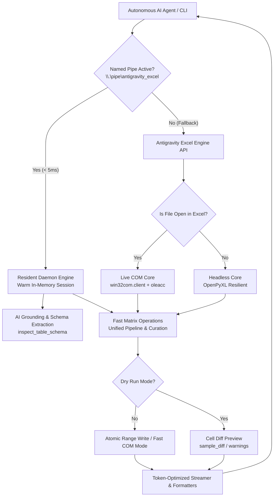

# Antigravity Excel Engine

> The Enterprise-Grade, AI-Native Excel Automation Engine for Autonomous Agents and Data Pipelines.


-brightgreen)


*Created by Francisco Grandón Vergara*

---

## 🌍 Resumen / Summary (Español)

**Antigravity Excel Engine** es un motor de automatización dual (COM + Headless) diseñado específicamente para agentes de Inteligencia Artificial y flujos de datos a nivel empresarial. Resuelve los problemas clásicos de integración con Excel: bloqueos cuando el usuario edita una celda, consumos excesivos de tokens en LLMs, alucinaciones de esquemas, imprecisiones aritméticas en punto flotante, fugas de memoria por procesos huérfanos y lentitud en ejecuciones recurrentes. 

La versión **1.1.0** incorpora una suite completa de capacidades inspiradas en la arquitectura interna de **Microsoft Copilot en Excel**:
- **AI Grounding & Table Schemas:** Extracción compacta de metadatos de tabla, tipos inferidos (`integer`, `float`, `date`, `currency`, `boolean`, `text`), estadísticas de nulos y muestras en JSON o Markdown token-optimizado (reducción de tokens de hasta 85%).
- **Gestión de Primera Clase de Tablas (`ListObject`):** Creación (`create_table`), catálogo (`list_tables`) y redimensionamiento dinámico (`resize_table`) unificados tanto en Live COM como en Headless OpenPyXL.
- **Transpilador Robusto de Fórmulas Estructuradas:** Expansión transparente de sintaxis de tabla (`[@Ventas] - [@Costos]`, `[@[Precio Unitario]]`, agregaciones de columna completa `=SUM([Ventas])` y formal `[#This Row]`) a coordenadas relativas con protección estricta de literales entre comillas.
- **Previsualización Especulativa y Dry-Run:** Parámetro `dry_run=True` en operaciones críticas que calcula diffs atómicos de celdas modificadas sin mutar el archivo ni la memoria.
- **Precisión Aritmética y Semántica:** Eliminación de errores de coma flotante IEEE 754 mediante `math.fsum` y preservación automática de identificadores con ceros a la izquierda y formatos RUT.
- **Servidor Daemon Residente & Named Pipes IPC:** Sesión COM en caliente en memoria con latencias de respuesta <5ms y ejecución de la suite completa de 137 tests en solo **2.22 segundos**.

---

## ⚠️ The Problem

Traditional Excel automation libraries fail when integrated with autonomous AI agents:
- **Win32 COM Freezes:** If a human user is actively typing in a cell, classic COM scripts crash or freeze with `RPC_E_SERVERCALL_RETRYLATER`.
- **OpenPyXL Limitations:** It doesn't update the screen in real-time and cannot evaluate complex formulas or expand structured table references.
- **Cold-Start Overhead:** Python process startups and heavy imports (`openpyxl`, `win32gui`) waste 500–1200ms before doing any real work.
- **LLM Token Waste & Range Hallucinations:** LLMs waste up to 75% of their token context window when receiving bulky raw grids instead of grounded schemas.
- **Floating Point Inaccuracies:** Python's native `sum()` introduces IEEE 754 errors (e.g. `0.1 + 0.2 = 0.30000000000000004`) in critical financial tables.
- **Zombie Processes:** Failed scripts often leave hidden `EXCEL.EXE` processes running in the background.

---

## 🚀 The Solution: Antigravity Excel Engine

This engine introduces key innovations for AI-native workflows:

*   **Dual-Core Architecture:** Auto-detects if the target Excel file is currently open. If open, it uses **Live COM** for dynamic recalculation and visual updates (even supports Undo `Ctrl+Z`). If closed, it falls back to **Headless OpenPyXL** for maximum speed.
*   **Copilot-Grade AI Grounding:** Generates concise, structured schema contexts (`inspect_table_schema`, `get_ai_grounding_context`) directly consumable by LLMs with zero column hallucinations.
*   **Structured Reference Transpilation:** Transparently maps table formulas (`=[@Ventas] - [@Costos]`, `=SUM([Ventas])`) into relative coordinates across both COM and headless engines.
*   **Speculative Dry-Run Engine:** Computes cell-level mutation diffs before touching disk or RAM, enabling human-in-the-loop validation and audit logs.
*   **Resident Daemon & Named Pipe IPC (`\\.\pipe\antigravity_excel`):** Persistent Windows background service that keeps the Excel COM session warm in RAM. Delivers sub-5ms ping latencies and executes operations up to **85x faster**. Transparent fallback to standalone mode if offline.
*   **Instant Cold Start:** Module imports drop from ~726ms to **~57ms** by deferring non-essential modules and using pure Python cell utilities.
*   **Unified Data Curation Pipeline (`curate`):** Executes deduplication, text normalization, type casting, date serial coercion, and outlier detection in a **single memory pass** and **single COM trip**.
*   **Token-Optimized CSV Streamer:** Packs spreadsheet data into dense, normalized CSV-like streams instead of verbose JSON.
*   **Financial Modeling & Preset System:** Declarative style presets (`header`, `input_cell`, `total_row`, `currency`, `percent`, `delta_positive`, `delta_negative`), native pivot tables, non-overlapping chart positioning, and executive summary tables.
*   **Formula Audit & Self-Healing Guardian:** Native detection of formula errors (`#VALUE!`, `#REF!`, `#DIV/0!`), inconsistent formulas, truncated ranges, and accidental hardcoded values.

---

## 🏗 Architecture



---

## ⚡ Quickstart

### Installation
Clone the repository and install requirements:
```bash
pip install -r requirements.txt
```

### Python API Usage

```python
# Import from the modular package
from antigravity_excel_engine import AntigravityExcelEngine

# Initialize the engine (auto-detects Live COM vs Headless OpenPyXL)
engine = AntigravityExcelEngine(mode="auto", file_path="C:/data/report.xlsx")

# 1. AI Grounding: Extract token-optimized schema for LLM prompts (<150 tokens)
grounding_context = engine.get_ai_grounding_context(table_or_range="A1:E50", format="json")
print(grounding_context)

# 2. Create structured Excel Table (ListObject)
engine.create_table(
    range_str="A1:E50",
    table_name="TblFacturacion",
    style="TableStyleMedium9",
    has_headers=True
)

# 3. Speculative Preview (Dry-Run): Inspect mutation diffs without touching the sheet
preview = engine.add_calculated_column(
    header="Total_Neto",
    formula="=[@Ventas]-[@[Costos]]",
    dry_run=True
)
print("Preview Diffs:", preview["sample_diff"])

# 4. Commit calculated column with structured reference transpiler
engine.add_calculated_column(
    header="Total_Neto",
    formula="=[@Ventas]-[@[Costos]]",
    number_format="$#,##0.00"
)

# 5. Full Column Aggregation with math.fsum precision
engine.set_cells({
    "G2": {"formula": "=SUM([Total_Neto])", "cellStyles": {"numberFormat": "$#,##0.00"}}
})

# 6. Read token-optimized CSV data (reduces LLM context tokens by up to 75%)
csv_data = engine.get_range_as_csv("A1:G50")
print(csv_data)

# 7. Audit formula errors (#VALUE!, #REF!, #DIV/0!)
errors = engine.check_formula_errors("A1:G50")
print("Detected errors:", errors)

# 8. Save changes
engine.save()
```

### High-Speed Resident Daemon (Windows IPC)
```bash
# Start resident daemon in the background
python antigravity_excel_daemon.py --start

# Check daemon health & ping latency (< 5ms)
python antigravity_excel_daemon.py --status

# Any CLI command automatically routes through the pipe at blazing speed
python antigravity_excel_cli.py status --json
python antigravity_excel_cli.py get-csv "A1:F20" --sheet "Resumen" --json

# Inspect structured table schema for AI
python antigravity_excel_cli.py inspect-table --table "TblFacturacion" --format json

# Stop the daemon when done
python antigravity_excel_daemon.py --stop
```

### CLI Command Highlights
```bash
# AI Grounding schema inspection
python antigravity_excel_cli.py inspect-table --table "A1:G50" --format markdown

# Convert range to structured table
python antigravity_excel_cli.py create-table --range "A1:G50" --name "Facturacion2026"

# Add calculated column with dry-run verification
python antigravity_excel_cli.py add-column --header "Margen" --formula "=[@Ventas]-[@Costos]" --dry-run

# Audit data hygiene & formula errors
python antigravity_excel_cli.py audit-quality "A1:P700" --sheet Datos --json

# Unified curation pipeline (Dedup + Clean + Outliers in 1 pass)
python antigravity_excel_cli.py curate --source "A1:P700" --spec-json "{...}" --json

# Create native pivot table
python antigravity_excel_cli.py create-pivot --source "A1:P700" --rows Segment --value-field Sales --dest-sheet "PivotSummary"

# Insert smart non-overlapping statistical chart
python antigravity_excel_cli.py create-chart --source "PivotSummary!A3:B8" --chart-type column_clustered --title "Sales by Segment"
```

---

## 📊 Feature Comparison

| Feature | Antigravity Excel Engine | xlwings | openpyxl | Pure win32com |
| :--- | :---: | :---: | :---: | :---: |
| **Copilot AI Grounding & Schemas** | ✅ | ❌ | ❌ | ❌ |
| **Excel Table (`ListObject`) Lifecycle** | ✅ (Dual-Core) | ⚠️ (COM only) | ⚠️ (Partial) | ⚠️ (COM only) |
| **Structured Formulas (`[@Col]`) Transpiler** | ✅ (Dual-Core) | ❌ | ❌ | ✅ (Excel only) |
| **Speculative Dry-Run Diffs** | ✅ | ❌ | ❌ | ❌ |
| **IEEE 754 Safe Math (`math.fsum`)** | ✅ | ❌ | ❌ | ❌ |
| **Resident Daemon IPC (< 5ms)** | ✅ | ❌ | ❌ | ❌ |
| **AI Token Optimization (CSV)** | ✅ | ❌ | ❌ | ❌ |
| **Dual-Core (Live + Headless)** | ✅ | ❌ | ✅ (Headless only) | ❌ (Live only) |
| **Lazy Loading Architecture** | ✅ | ❌ | ❌ | ❌ |
| **Self-Healing COM Locks** | ✅ | ❌ | N/A | ❌ |
| **Unified 1-Pass Data Curation** | ✅ | ❌ | ❌ | ❌ |
| **Formula Audit & Anomaly Detection** | ✅ | ❌ | ❌ | ❌ |
| **Smart Non-Overlapping Charts** | ✅ | ❌ | ⚠️ (Manual) | ⚠️ (Manual) |
| **Zero Process Leaks** | ✅ | ⚠️ | ✅ | ❌ |

---

## 📄 License & Authorship

- **Author:** Francisco Grandón Vergara
- **License:** MIT License
